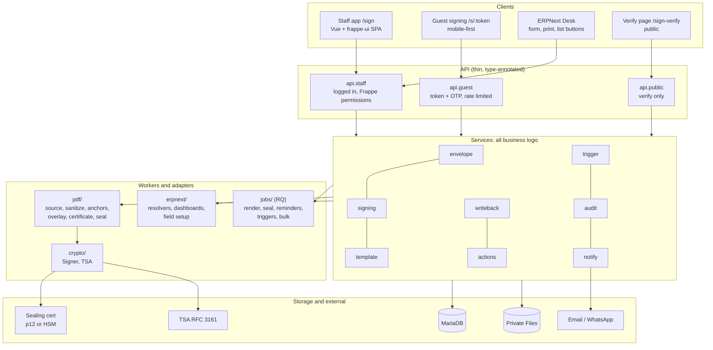
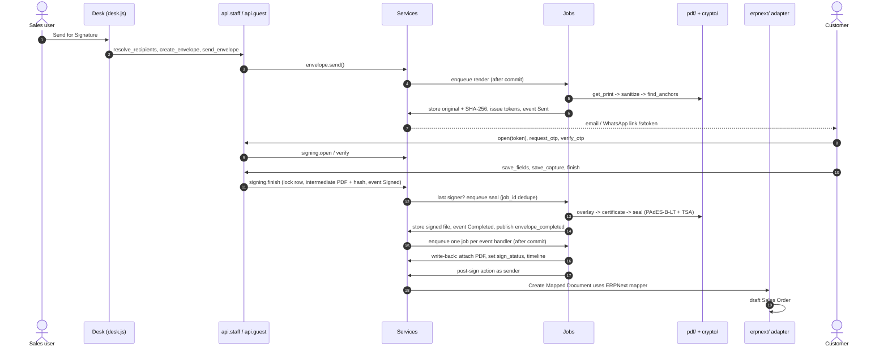

# Frappe Sign: Architecture

`frappe_sign` is an e-signature app for Frappe and ERPNext v16 (all minors, see D15). Any document can be sent for signature from its own Print Format, signed by external parties via link, sealed with a PAdES signature, and written back to the source document.

Five layers, one rule: clients only talk to thin APIs, APIs only call services, and services are the single home for business logic. PDF work, ERPNext specifics and slow tasks are delegated to workers and adapters.

## Layers



### Layer rules

| Layer | May import | Must not |
| --- | --- | --- |
| `api/` | `services/`, `utils/` | Contain business rules, call `frappe.db.commit()` |
| `services/` | `pdf/`, `crypto/`, `utils/`, DocType classes, `frappe` | Import from `erpnext` directly; commit transactions |
| `pdf/` | `pypdf`, `reportlab`, `pyhanko`, `pdf/types.py` | Import `frappe`, except `source.py` and `certificate.py`. Raise `exceptions.py` errors (raise `PdfError` subclasses from `pdf/types.py`, which services translate) |
| `crypto/` | `pyhanko`, `cryptography` | Touch DocTypes (receives decrypted material from services) |
| `erpnext/` | `services/`, `erpnext` (guarded) | Be imported by core code; only loaded via hooks registry when ERPNext is installed |
| `jobs/` | `services/` | Hold logic; they are transaction boundaries only. Every enqueued function is a `jobs/` entry point; services are never enqueued directly |
| DocType controllers | `utils/`, `exceptions`, `compat`, `crypto/pkcs12.py` | Hold business logic beyond validation and state guards |
| `jinja/` | `pdf/anchors.py`, `pdf/source.py`, `utils/` | Hold logic beyond writing the anchor markup; the marker format lives in `pdf/anchors.py` only |
| `utils/`, `exceptions.py`, `compat.py` | `frappe`, each other (`utils/` raises `exceptions.py` errors) | Import any other app layer; any layer except `pdf/` and `crypto/` may import them |

## Request flow: a customer signs a Quotation



## Repository layout

```text
frappe_sign/
├── CLAUDE.md                     Instructions for Claude Code
├── docs/                         ARCHITECTURE, DESIGN, DECISIONS, PLAN
├── frontend/                     Vite project
│   ├── src/staff/                staff app entry, routes, pages
│   ├── src/guest/                guest signing entry, pages
│   ├── src/shared/               pdf viewer, field components, composables, api client, types
│   └── tests/                    Vitest
├── e2e/                          Playwright
├── package.json                  root "build" delegates to frontend/
├── pyproject.toml
└── frappe_sign/
    ├── hooks.py                  routes, jinja, doc_events "*", scheduler, frappe_sign_* hooks
    ├── compat.py                 feature-detected shims for anything newer than v16.0.0
    ├── frappe_sign/doctype/      17 DocTypes (module "Frappe Sign")
    ├── api/                      staff.py, guest.py, public.py
    ├── services/                 envelope.py, signing.py, template.py, trigger.py, audit.py, notify.py, events.py, writeback.py, actions.py
    ├── pdf/                      types.py, source.py, sanitize.py, anchors.py, overlay.py, certificate.py, seal.py, fonts/
    ├── crypto/                   signer.py (Signer, Pkcs12Signer, RemoteSigner), pkcs12.py (inspect only), tsa.py
    ├── erpnext/                  resolvers/, dashboards.py, setup.py (custom fields, Link Company)
    ├── jobs/                     render.py, seal.py, events.py, actions.py, bulk.py, reminders.py, triggers.py, housekeeping.py
    ├── utils/                    small shared helpers (hashing, dates, paths)
    ├── jinja/                    sign_field() anchor helper
    ├── exceptions.py             domain errors with HTTP codes and stable codes
    ├── public/js/desk.js         form, print view and list view integration
    ├── public/frontend/          build output (gitignored)
    ├── templates/                certificate.html, emails/
    ├── www/                      sign.html/.py, s.html/.py, sign-verify.html/.py
    ├── commands/                 bench frappe-sign verify
    ├── patches/
    └── tests/                    unit/, integration/, erpnext/, security/, fixtures/pdfs/
```

## Runtime topology

- **Web workers** serve the SPA shells, API and PDF streams.
- **RQ queues:**
  - `default`: render and send, event handlers, post-sign actions, trigger dispatch.
  - `long`: seal (TSA network call), bulk send.
  - `short`: notifications.
- **Scheduler:** reminders and expiry every 15 minutes; certificate warnings, session purge and date triggers daily.
- **Redis:** rate limiter counters, trigger DocType cache, job deduplication.
- **Realtime (socket.io):** envelope status updates to the staff app.

## Extension points

| Hook in `hooks.py` | Purpose |
| --- | --- |
| `frappe_sign_resolvers` | Map a DocType to a resolver that returns suggested recipients |
| `frappe_sign_events` | Subscribe handlers to domain events (`envelope_sent`, `recipient_viewed`, `recipient_signed`, `envelope_declined`, `envelope_voided`, `envelope_completed`) |
| `frappe_sign_post_sign_actions` | Register extra post-sign action types |

Other apps declare these in their own `hooks.py`; `frappe.get_hooks()` merges them.

## Compatibility (D15)

- Frappe and ERPNext `>=16.0.0,<17.0.0`. Floor APIs verified against the `v16.0.0` tag.
- Python `>=3.14,<3.15`, Node `>=24`.
- Newer APIs only via `compat.py` with feature detection.
- CI matrix: `v16.0.0` floor and `version-16` head, each with and without ERPNext.
- Print Formats using either `wkhtmltopdf` or `chrome` generator are supported and tested. Generators added after v16.0.0 (Typst, WeasyPrint) render, but anchors are not tested for them, and the send wizard shows a warning.