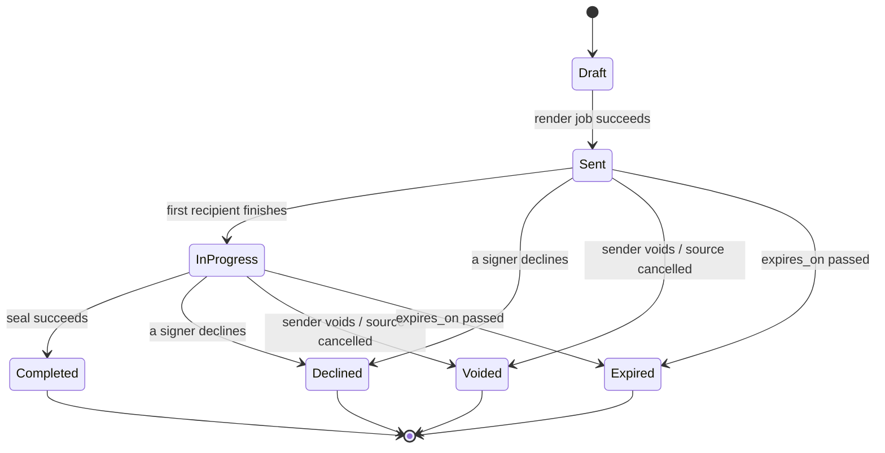

# Frappe Sign: Design

Detailed design for `frappe_sign`. Read [ARCHITECTURE.md](ARCHITECTURE.md) first and [DECISIONS.md](DECISIONS.md) for the reasoning behind each choice.

Contents:

1. Goals and scope
2. Data model
3. State machines
4. ERPNext integration
5. Signing flow and security
6. PDF pipeline
7. Frontend
8. API, jobs and notifications
9. Testing strategy
10. Risks and open questions

---

## 1. Goals and scope

**Goals**

- Sign any Frappe or ERPNext document (Quotation, Sales Order, Purchase Order, Contract, Job Offer, Employee documents, custom DocTypes) in two clicks from its form.
- PDFs that Adobe Reader shows as signed and unmodified, with a trusted timestamp and an appended certificate of completion.
- Close the loop: signed PDF attached to the source document, status field updated, optional automatic next step.
- Modern Vue 3 + frappe-ui UI for designing templates, sending, tracking and guest signing, good on phones, with full Arabic RTL support.
- Runs on every Frappe and ERPNext v16 release (D15).

**Non-goals for v1**

- Qualified electronic signatures via UAE PASS or a licensed trust service provider (Phase 4; designed for, not built).
- A standalone SaaS outside Frappe.
- Editing PDF content. Fields are placed on a fixed PDF.

**Users**

- Internal senders (sales, HR, procurement) with Desk access.
- External signers who sign via link without an account.
- Admins who configure templates, triggers, profiles and certificates.

**Roles (fixtures)**

| Role | Can |
| --- | --- |
| Sign Manager | Everything: profiles, templates, triggers, all envelopes. Sign Certificate: `select` only, so a Profile can link one but the private `.p12` cannot be read |
| Sign User | Create and send envelopes from published templates; see envelopes they sent or are recipients of |
| System Manager | Same as Sign Manager, plus Sign Certificate |

Envelope visibility for Sign User is enforced with `permission_query_conditions` and `has_permission` hooks (sender, or recipient by user email, or shared via standard Frappe sharing).

---

## 2. Data model

Seventeen DocTypes in module **Frappe Sign**. Envelopes link to an immutable template version, never to the live template.

### 2.1 Configuration

**Sign Settings** (Single)

| Field | Type | Notes |
| --- | --- | --- |
| default_expiry_days | Int | Default 14 |
| default_reminder_days | Int | Default 3; 0 disables |
| otp_validity_minutes | Int | Default 10 |
| max_upload_mb | Int | Default 20 |
| max_pages | Int | Default 200 |
| tsa_urls | Small Text | One URL per line, tried in order |
| consent_text | Text Editor | Electronic records disclosure shown to signers |
| consent_version | Int | Read only, incremented on change |
| enabled_doctypes | Table (Sign Enabled DocType) | DocTypes that get custom fields and the Desk button |

**Sign Enabled DocType** (child): `reference_doctype` (Link DocType), `default_template` (Link Sign Template).

**Sign Profile** (one per Company, autoname `field:company`)

| Field | Type | Notes |
| --- | --- | --- |
| company | Link Company | Dynamic: Link to Company if ERPNext installed, else Data |
| sealing_certificate | Link Sign Certificate | |
| sender_email_account | Link Email Account | |
| authorised_signatory | Link User | Default company-side signer |
| logo | Attach Image | |
| stamp_image | Attach Image | Private; default image for Company Stamp fields |
| brand_color | Color | |
| legal_footer | Small Text | Printed on certificate and emails |
| whatsapp_enabled | Check | Only effective if `frappe_whatsapp` installed |

Implementation note on `company`: create the field as Data in JSON; in ERPNext setup (`erpnext/setup.py`) switch it to Link Company via Property Setter. Core code treats it as a string. On a site without ERPNext, `company` is a free-text company name.

Customize Form does not allow a Data to Link change, so `erpnext/setup.py` writes the Property Setters (`fieldtype`, `options`) directly. Both types use the same `varchar(140)` column. Rules:

1. Run the setup in `after_install` when ERPNext is present, and in `after_app_install` when ERPNext is installed later.
2. Before the switch, find values that do not match a Company name. Report them and do not switch until they are fixed.
3. Remove the Property Setters in `before_app_uninstall` for ERPNext.
4. Test the switch on the v16.0.0 floor.

**Sign Certificate** (System Manager only)

| Field | Type | Notes |
| --- | --- | --- |
| title | Data | |
| company | Data / Link Company | As above |
| kind | Select | Self-signed, CA-issued, AATL |
| storage | Select | PKCS#12 File, Remote (Phase 3) |
| p12_file | Attach | Private |
| p12_password | Password | Encrypted with site key |
| remote_config | JSON | Phase 3 (PKCS#11 or CSC endpoint) |
| subject, issuer | Small Text, read only | Parsed on save. Distinguished names can exceed 140 characters |
| valid_from, valid_to | Datetime, read only | Parsed on save |
| fingerprint_sha256 | Data, read only | |

`validate` parses the PKCS#12 and rejects expired, wrong-password, or key-less files.

### 2.2 Templates

**Sign Template**

| Field | Type | Notes |
| --- | --- | --- |
| title | Data | |
| company | Data / Link | |
| source_type | Select | Print Format, Uploaded PDF |
| reference_doctype | Link DocType | Required for Print Format source |
| print_format | Link Print Format | Filtered by reference_doctype |
| letter_head | Link Letter Head | |
| pdf_file | Attach | Private; Uploaded PDF source |
| page_metrics | JSON | `[{page, width, height, rotation}]` in points |
| signing_order | Select | Sequential, Parallel |
| otp_mode | Select | Off, Email, WhatsApp |
| expiry_days | Int | Overrides settings |
| reminder_days | Int | Overrides settings |
| email_template | Link Email Template | Invitation |
| post_sign_action | Select | None, Submit, Apply Workflow Action, Create Mapped Document, Set Field Value, Call Method |
| post_sign_config | JSON | Action parameters |
| published_version | Link Sign Template Version | Read only |
| is_active | Check | |
| roles | Table (Sign Template Role) | |
| fields | Table (Sign Template Field) | |

**Sign Template Role** (child)

| Field | Type | Notes |
| --- | --- | --- |
| role_label | Data | e.g. Customer, Company |
| routing_order | Int | Ignored when Parallel |
| kind | Select | Signer, Approver, CC |
| signer_source | Select | Fixed User, Doc Field, Party Contact, Employee, Ask at Send |
| source_field | Data | Field path for Doc Field |
| fixed_user | Link User | |
| can_delegate | Check | |
| color | Color | Designer color |

**Sign Template Field** (child)

| Field | Type | Notes |
| --- | --- | --- |
| field_key | Data | Unique within template |
| role_label | Data | Must match a role |
| field_type | Select | Signature, Initials, Full Name, Email, Date Signed, Text, Number, Checkbox, Dropdown, Company Stamp, Attachment |
| page | Int | 1-based; 0 means "from anchor" |
| x, y, w, h | Float | 0..1, top-left origin, visible page box |
| anchor_tag | Data | Set when placed by `sign_field()` |
| required | Check | |
| read_only | Check | Prefilled and locked |
| prefill_path | Data | Doc field path or Jinja expression |
| options | Small Text | Dropdown options, one per line |
| font_size | Float | Default 11 |
| validation_regex | Data | Optional |

Field types that need a note:

- **Company Stamp:** the signer uses `Sign Profile.stamp_image` or uploads an image.
- **Attachment:** the signer uploads a file. It is stored as a private File in `value` and listed on the certificate. It is not merged into the PDF in v1.

**Sign Template Version** (insert only): `template`, `version_no`, `snapshot` (JSON of template + roles + fields), `source_sha256` (uploaded PDF hash), `published_by`, `published_on`.

### 2.3 Envelopes

**Sign Envelope** (autoname `SIGN-.YYYY.-.#####`)

| Field | Type | Notes |
| --- | --- | --- |
| title | Data | |
| company | Data / Link | |
| template_version | Link Sign Template Version | Null for ad-hoc envelopes |
| reference_doctype | Link DocType | |
| reference_name | Dynamic Link | |
| party_type, party | Link DocType, Dynamic Link | Primary signer's party, for dashboards |
| status | Select | Draft, Sent, In Progress, Completed, Declined, Voided, Expired |
| send_state | Select | Not Started, Queued, Failed. The envelope stays Draft until the render job sets Sent |
| send_error | Small Text | Read only; reason of the last failed send |
| sealing_state | Select | Not Started, Queued, Sealing, Sealed, Failed |
| signing_order | Select | Copied from template |
| otp_mode | Select | Copied from template |
| original_file | Link File | Frozen PDF |
| original_sha256 | Data | |
| signed_file | Link File | Final sealed PDF |
| signed_sha256 | Data | |
| audit_head | Data | Hash chain head at completion |
| source_changed | Check | |
| sent_on, completed_on, expires_on | Datetime | |
| sender | Link User | |
| message | Small Text | Shown to signers |
| void_reason | Small Text | |
| recipients | Table (Sign Envelope Recipient) | |
| fields | Table (Sign Envelope Field) | |

**Sign Envelope Recipient** (child)

| Field | Type | Notes |
| --- | --- | --- |
| role_label | Data | |
| routing_order | Int | |
| kind | Select | Signer, Approver, CC |
| party_type, party | Link, Dynamic Link | |
| contact | Link Contact | |
| full_name, email, mobile | Data | |
| status | Select | Pending, Sent, Viewed, Signed, Declined, Delegated |
| token_hash | Data | SHA-256 hex, indexed |
| token_expires_on | Datetime | |
| viewed_on, signed_on | Datetime | |
| intermediate_file | Link File | Private PDF rendered at this signer's finish (D3) |
| intermediate_sha256 | Data | Hash of `intermediate_file` |
| decline_reason | Small Text | |
| delegated_to | Data | Row name of the new recipient |

**Sign Envelope Field** (child): copy of template field resolved to a page and rect, plus `recipient_row`, `value`, `capture` (Link Sign Capture), `filled_on`.

**Sign Capture** (insert only): `envelope`, `recipient_row`, `field_key`, `method` (Draw, Type, Upload), `image` (private File), `sha256`.

**Sign Session**: `envelope`, `recipient_row`, `session_hash`, `otp_hash`, `otp_attempts`, `otp_sent_on`, `otp_expires_on`, `verified_on`, `last_seen_on`, `expires_on`, `ip`, `user_agent`.

**Sign Event** (insert only)

| Field | Type | Notes |
| --- | --- | --- |
| envelope | Link Sign Envelope | Indexed |
| seq | Int | 1-based per envelope |
| recipient_row | Data | |
| event | Select | Created, Sent, Delivered, Viewed, OTP Sent, OTP Verified, Consented, Field Filled, Signed, Declined, Delegated, Reminded, Voided, Expired, Source Changed, Sealed, Completed, Downloaded |
| at | Datetime(6) | UTC, stored naive. Only Sign Event uses UTC; the UI converts it for display |
| actor | Data | User or recipient email |
| ip | Data | |
| user_agent | Small Text | Browser user agents often exceed 140 characters (also on Sign Session) |
| payload | JSON | Event specific (hashes, consent version) |
| prev_hash, hash | Data | Chain |

### 2.4 Automation

**Sign Trigger**: `reference_doctype`, `event` (Submit, Save, Workflow State, Value Change, Date), `workflow_state`, `watch_field`, `date_field`, `days_offset`, `condition` (Code, evaluated with `frappe.safe_eval`), `template`, `mode` (Create Draft, Send), `enabled`.

**Sign Trigger Log**: `trigger`, `reference_doctype`, `reference_name`, `status` (Queued, Created, Sent, Skipped, Failed), `envelope`, `error` (Code).

**Sign Saved Signature** (owner only): `user`, `kind` (Signature, Initials), `image`.

### 2.5 Custom fields on enabled DocTypes

Created with `frappe.custom.doctype.custom_field.custom_field.create_custom_fields` when a DocType is added to `Sign Settings.enabled_doctypes`; removed only on explicit admin action.

| Field | Type | Notes |
| --- | --- | --- |
| sign_status | Select | Not Sent, Sent, Partially Signed, Signed, Declined, Voided, Expired; `allow_on_submit`, read only, in list view |
| sign_envelope | Link Sign Envelope | `allow_on_submit`, read only |

### 2.6 Integrity rules

- Sign Event, Sign Capture and Sign Template Version: no write or delete permission for any role. Controllers raise `ImmutableRecord` in `before_validate` when the document is not new, and in `on_trash`. The guards run in `before_validate` because `flags.ignore_validate` skips `validate` but not `before_validate`.
- A Sign Envelope past Draft rejects changes to anything except fields the service sets via `db_set`. A Draft with `send_state = Queued` is also locked, because the render job is reading it. Only Draft envelopes can be deleted.
- Service-owned fields (status, states, files, hashes, dates, recipient progress and tokens) cannot be set through `save()`, even on a Draft. They are `no_copy`, so Duplicate starts a clean Draft.
- Sign Event has a unique key on `(envelope, seq)`, so the database refuses a forked chain.
- Services never call `save()` on an envelope past Draft. To add a recipient (delegation), insert the child row directly with `parent`, `parenttype` and `parentfield` set. Then move that recipient's Sign Envelope Field rows to the new row with `db_set`.
- Tokens, session secrets and OTPs are stored only as SHA-256 hashes.

---

## 3. State machines

### Envelope



`Completed` is set only after `sealing_state = Sealed`. While sealing, the envelope stays `In Progress` with `sealing_state` showing progress. This also applies to an envelope with one signer. `source_changed` is a flag, not a state.

Send is asynchronous. `send_envelope` sets `send_state = Queued` and the envelope stays Draft. The render job freezes the PDF, issues tokens and sets Sent. If the render fails, or a required anchor is missing in the frozen PDF, the job sets `send_state = Failed` with `send_error` and notifies the sender. The envelope stays Draft and can be sent again.

If sealing fails after the last retry, the envelope stays `In Progress` with `sealing_state = Failed`. A Sign Manager starts a new seal with `retry_seal`.

### Recipient

`Pending -> Sent -> Viewed -> Signed`, with `Declined` and `Delegated` as terminal alternatives from `Sent` or `Viewed`. In sequential mode only the lowest pending `routing_order` group is `Sent`. CC recipients go `Pending -> Sent` on completion.

An Approver follows the same path as a Signer but has no fields. `finish` is the approval. It writes a `Signed` event with `kind: Approver` in the payload. Sealing starts when every Signer and Approver is `Signed`. CC recipients do not count.

All transitions live in `services/envelope.py` and `services/signing.py` as explicit functions with guard clauses; an invalid transition raises `InvalidTransition`.

---

## 4. ERPNext integration

Lives in `frappe_sign/erpnext/`, registered through hooks, active only when ERPNext is installed (D4).

### 4.1 Entry points

- **Form view:** "Send for Signature" button and a status indicator, added by `public/js/desk.js` (loaded via `app_include_js`) on the `form-refresh` event, only for DocTypes listed in `frappe.boot.frappe_sign.enabled_doctypes`.
- **Print view:** "Send this print for signature" uses the selected Print Format and Letter Head.
- **List view:** bulk "Send for Signature" for selected documents (queued, one envelope each).
- **Workspace:** "Signatures" with number cards: awaiting me, awaiting others, completed this month, expiring in 3 days.

The Desk button opens a `frappe.ui.Dialog` (plain Frappe JS, no Vue) with template choice and resolved recipients for one-click sending. "Customize" opens `/sign/new?doctype=...&name=...` in the SPA.

### 4.2 Anchor tags

Registered through the `jinja` hook (`methods`):

```jinja
{{ sign_field("signature", role="Customer", width=60, height=20) }}
{{ sign_field("date_signed", role="Customer") }}
{{ sign_field("company_stamp", role="Company", width=40, height=40) }}
```

- Renders an inline-block span sized `width x height` in mm containing a marker string `[[fs:<role>:<field_type>:<n>]]` in 1pt white text at the top-left, plus an optional dotted border placeholder.
- After rendering, `pdf/anchors.py` locates markers using pypdf `extract_text(visitor_text=...)`, reads their page and baseline position, and builds a normalized rect from the declared size.
- Markers are removed from the visual output by the overlay step drawing a white rect under the field area before the field value (the marker is 1pt white text anyway).
- Must work with both `wkhtmltopdf` and `chrome` generators; fixtures cover both.
- `n` disambiguates multiple fields of the same type and role.

### 4.3 Signer resolution

Resolvers are registered per DocType through `frappe_sign_resolvers` and return a list of suggested recipients `{role_label, party_type, party, contact, full_name, email, mobile}`.

| Source DocType | Default signer | Email / mobile from |
| --- | --- | --- |
| Quotation | `quotation_to` + `party_name` (Customer or Lead) | `contact_person` Contact, else `contact_email` |
| Sales Order | Customer | `contact_person` Contact, else `contact_email` |
| Purchase Order | Supplier | `contact_person` Contact, else `contact_email` |
| Contract | `party_type` + `party_name` | Party's primary Contact |
| Job Offer (HRMS, if installed) | Job Applicant | `applicant_email` |
| Employee-linked docs | Employee | Employee preferred email, `cell_number` |
| Any DocType | Template role with `signer_source = Doc Field` | Value at `source_field` |
| Company side | Template `fixed_user` or Sign Profile `authorised_signatory` | User email |

Field names must be verified against the ERPNext v16.0.0 DocType JSON in tests; resolvers read fields with `doc.get()` so a missing field yields "unresolved", never an exception. The send dialog always lets the user correct recipients.

### 4.4 Prefill

Template fields with `prefill_path` take a field path (`customer_name`, `grand_total`) or a Jinja expression (`{{ doc.items | length }}`) rendered with `frappe.render_template` in a restricted context `{doc}`. Read-only prefilled values are burned in at send and recorded in the `Sent` event payload.

### 4.5 Write-back on completion

Handler `services/writeback.py` subscribed to `envelope_completed` and `recipient_signed`:

1. Attach signed PDF to the source document (private File, `attached_to_doctype/name`).
2. `db_set` `sign_status` and `sign_envelope` (works on submitted documents).
3. Timeline comment: "Signed by Ahmed Khan (Customer) on 2026-11-02 14:31 GST".
4. Signing emails are sent with `reference_doctype/reference_name` of the source doc, so they appear in its timeline as Communications.

Generic write-back (attach, status, comment) does not need ERPNext and lives in `services/`; only party dashboards and mapped documents are ERPNext-specific.

### 4.6 Post-sign actions

Run in a background job as the envelope `sender` (`frappe.set_user`), so the sender's permissions apply. Failures are logged as a Sign Event payload and an Error Log, and the sender is notified; the signature is never rolled back.

| Action | Config | Example |
| --- | --- | --- |
| None | | Default |
| Submit | | Submit a Draft Contract once both sides sign |
| Apply Workflow Action | `action` | Quotation to "Accepted" via `frappe.model.workflow.apply_workflow` |
| Create Mapped Document | `method` (dotted path of a mapper), `save` | `erpnext.selling.doctype.quotation.quotation.make_sales_order`, saved as Draft |
| Set Field Value | `fieldname`, `value` | `custom_signed_on = now` |
| Call Method | `method` | Any whitelisted dotted path, called with `(envelope, doc)` |

Extra action types can be registered via `frappe_sign_post_sign_actions`.

### 4.7 Lifecycle sync

- Source cancelled or deleted: open envelopes voided, signers notified, event `Voided`.
- Source saved while an envelope is open: `source_changed = 1`, event `Source Changed`, sender notified with "Void and resend".
- Source amended: user can create a new envelope from the amendment; the old one is voided with a reference.

These run through the same `*` dispatcher as triggers (D8), gated by a cached set of DocTypes with open envelopes or triggers.

### 4.8 Dashboards and portal

- `override_doctype_dashboards` adds a "Signatures" group to Customer, Supplier and Employee dashboards via `party_type` / `party` on Sign Envelope.
- Portal menu item "My Documents" lists envelopes where the logged-in user's email is a recipient, with signed copy download.

---

## 5. Signing flow and security

### 5.1 Signer journey

1. **Send.** PDF frozen and hashed, recipients created, tokens issued, event `Sent`, invitation email (and WhatsApp if enabled) with `/s/<token>`.
2. **Open.** Token hashed and looked up. Envelope status, expiry and routing checked. Sequential mode: a signer whose turn has not come sees "Waiting for Ahmed Khan to sign first". Event `Viewed` once per session.
3. **Verify.** If `otp_mode` is set: 6-digit code, stored hashed, `otp_validity_minutes` expiry, 5 attempts per code, 60 s resend cooldown. `request_otp` creates an unverified Sign Session that holds the OTP hash and attempts. Success sets `verified_on` and issues the session secret. If `otp_mode` is Off, `open` creates a verified session.
4. **Consent.** Signer accepts the disclosure; `consent_version` recorded in event `Consented`.
5. **Fill and sign.** Fields validated on the server (type, required, regex, options). Signature drawn, typed or uploaded and stored as a Sign Capture. Signer may Decline (reason required) or Delegate (if allowed).
6. **Finish.** Server takes `SELECT ... FOR UPDATE` on the envelope row and re-validates required fields. It renders an intermediate PDF with all values saved so far, in the request (D3). It stores the PDF as a private File, records its SHA-256 on the recipient and in event `Signed`, and notifies the next routing group.
7. **Complete.** Last signer triggers sealing (5.4). After `Sealed`, status `Completed`, all parties emailed the signed PDF, `envelope_completed` published.

Company-side signers (fixed users and the authorised signatory) use the same `/s/<token>` link and flow, so there is one audit path. The staff home card links to it. If the browser has a logged-in user whose email matches the recipient email, the guest app offers that user's Sign Saved Signatures.

### 5.2 Guest access controls

- Token: `secrets.token_urlsafe(32)`; store `sha256(token)` only; rotate on resend.
- Session: on open (OTP off) or OTP verify, issue a 32-byte session secret, store its hash, return it to the SPA. The SPA keeps it in memory and sends `X-Sign-Session` on each call. No cookie, so no CSRF surface. 30 min idle, 24 h absolute.
- Rate limits (`@rate_limit`, IP based unless noted): `open` 30/min; `request_otp` 5/hour keyed by recipient; `verify_otp` 10/10 min; `save_*` 120/min.
- Guest responses are recipient-scoped: no source document name, no other recipients' emails, only fields assigned to this recipient are editable.
- Guest endpoints set `frappe.flags.ignore_permissions` only inside `services/signing.py` after a session check, each with a comment naming that check.
- PDFs stream from a session-checked endpoint with `Cache-Control: no-store` and `Content-Disposition: inline`. `get_pdf` serves the latest intermediate PDF, or the original if nobody has finished.
- The token is in the URL path, so web server access logs record it. Guest pages set `Referrer-Policy: no-referrer` so the token does not leak to other sites. The admin guide states the log exposure. Expiry, rotation on resend and OTP limit the risk.

### 5.3 Cryptography

- Sealing certificate per Company (Sign Certificate). Password via `get_password`. Decrypted material exists only inside the seal job.
- `crypto/signer.py`:

```python
class Signer(Protocol):
    def pyhanko_signer(self) -> "pyhanko.sign.signers.Signer": ...

class Pkcs12Signer:  # Phase 1
    def __init__(self, p12: bytes, password: bytes) -> None: ...

class RemoteSigner:  # Phase 3: PKCS#11 or CSC
    def __init__(self, config: dict) -> None: ...
```

- `crypto/tsa.py`: tries each URL in `Sign Settings.tsa_urls` in order with a 10 s timeout.

### 5.4 Sealing

- Triggered when the last signer finishes. `services/signing.finish` holds the envelope row lock (5.1), re-checks that all Signers and Approvers are done and `sealing_state = Not Started`, sets `Queued`, and enqueues `jobs.seal.run` with `job_id=f"frappe_sign::seal::{envelope}"`, `deduplicate=True`, `enqueue_after_commit=True`.
- The job sets `Sealing`, runs overlay, certificate, seal; on success stores the file, sets `Sealed`, writes events `Sealed` and `Completed`. On failure sets `Failed`, retries with backoff (1, 5, 30 min), alerts the sender after the last retry.
- `retry_seal` (Sign Manager) accepts only `sealing_state = Failed`. It sets `Queued` under the row lock and enqueues the same deduplicated job.

### 5.5 Audit chain

- `hash = sha256(prev_hash + canonical_json(event))` where canonical JSON has sorted keys, no whitespace, UTC timestamps with microseconds. First event uses `prev_hash = sha256(envelope name)`.
- The hashed fields are `envelope`, `seq`, `recipient_row`, `event`, `at`, `actor`, `ip`, `user_agent` and `payload`. Frappe metadata (`name`, `owner`, `creation`, `modified`) and the hash fields are not hashed.
- `seq` is assigned under the envelope row lock to avoid gaps or forks.
- At completion `audit_head` is written to the envelope and printed on the certificate.
- `bench --site <site> frappe-sign verify <envelope>` recomputes the chain and file hashes and reports the first mismatch.

### 5.6 Verify page

`/sign-verify`: upload a PDF or enter an envelope ID. Checks SHA-256 against `signed_sha256` and runs pyHanko validation; shows signers, timestamps and seal status. No document content shown to anonymous users. Rate limited.

### 5.7 Legal note

UAE law recognises electronic signatures (Federal Decree-Law No. 46 of 2021 on electronic transactions and trust services), with stronger standing for signatures from licensed trust service providers. Which level a client's contracts need is for their counsel.

---

## 6. PDF pipeline

Pure stages, bytes in, bytes out, in `frappe_sign/pdf/`. Types are dataclasses in `pdf/types.py`. Only `source.py` and `certificate.py` import `frappe`.

Stages raise `PdfError` subclasses from `pdf/types.py` (`PdfEncrypted`, `PdfTooLarge`, `PdfTooManyPages`, `AnchorNotFound`). Services translate them to the errors in 8.4.

| Stage | Module | Does | Library |
| --- | --- | --- | --- |
| 1. Source | `source.py` | `frappe.get_print(doctype, name, print_format, letterhead=..., as_pdf=True)`, or uploaded bytes | Frappe |
| 2. Sanitize | `sanitize.py` | Reject encrypted; enforce size and page caps; strip JavaScript, OpenAction, AA, EmbeddedFiles, AcroForm | pypdf |
| 3. Locate | `anchors.py` | Find `[[fs:...]]` markers; normalized rects against visible box with rotation | pypdf |
| 4. Overlay | `overlay.py` | Per-page reportlab canvas with values and capture PNGs, merged into page content | reportlab, pypdf |
| 5. Certificate | `certificate.py` | Jinja `templates/certificate.html` rendered to PDF via `frappe.utils.pdf.get_pdf`; appended | Frappe, pypdf |
| 6. Seal | `seal.py` | PAdES-B-LT with `Signer`, TSA, revocation info | pyHanko |

Interfaces:

```python
def render_print(doctype: str, name: str, print_format: str | None,
                 letter_head: str | None) -> bytes: ...
def sanitize(pdf: bytes, *, max_bytes: int, max_pages: int) -> SanitizedPdf: ...
def page_metrics(pdf: bytes) -> list[PageMetric]: ...
def find_anchors(pdf: bytes) -> list[Anchor]: ...
def apply_fields(pdf: bytes, fields: list[PlacedField],
                 captures: dict[str, bytes], fonts: FontSet) -> bytes: ...
def append_certificate(pdf: bytes, certificate_pdf: bytes) -> bytes: ...
def seal_pdf(pdf: bytes, *, signer: Signer, tsa_urls: list[str],
             reason: str, location: str, contact: str) -> bytes: ...
```

**Details that bite if ignored**

- **Arabic.** reportlab does not shape Arabic. Text values run through `arabic_reshaper.reshape` then `bidi.algorithm.get_display`, drawn with bundled Noto Naskh Arabic; Latin with Noto Sans; both embedded (OFL licensed fonts in `pdf/fonts/`). Typed signatures offer one Arabic and two Latin script fonts.
- **Rotation and CropBox.** Normalized coordinates are relative to the visible, rotated box. `pdf/types.py` exposes one conversion function used by overlay and anchors; the frontend has the mirror in `shared/coords.ts`. Both are tested against the same fixtures.
- **Concurrency.** See 5.4. Exactly one seal per envelope.
- **Idempotency.** Each stage's output hash is logged; a retried job reuses stored intermediates.
- **Drift.** Rendering happens once, at send (D6).
- **Generator.** In v16.0.0, `get_print` reads the Print Format's `pdf_generator` when none is passed, so `source.py` does not pass it. `get_print` writes `pdf_generator`, `letterhead` and other keys to `frappe.local.form_dict`. `source.py` saves `form_dict` and restores it after the call.
- **Memory.** Process page by page where possible; caps from settings.

---

## 7. Frontend

### 7.1 Stack

| Concern | Choice |
| --- | --- |
| Framework | Vue 3 `<script setup>`, TypeScript strict |
| UI kit | frappe-ui (pinned version) and its Tailwind preset |
| Server data | frappe-ui `createResource`, `createListResource`, `createDocumentResource` |
| Local state | Pinia, only for the designer (selection, undo and redo) |
| Router | vue-router, history mode, base `/sign` (staff) and `/s` (guest) |
| Realtime | frappe-ui socket |
| PDF | `pdfjs-dist`, lazy page rendering via IntersectionObserver |
| Signature pad | `signature_pad` |
| Drag and resize | own `useDragResize` composable on pointer events |
| Tests | Vitest + Vue Test Utils; Playwright end to end |

Build output to `frappe_sign/public/frontend/`; a post-build script copies HTML shells to `frappe_sign/www/sign.html` and `www/s.html`. Their `.py` controllers inject boot data: CSRF token (staff only), user, language and direction, Sign Profile branding. `website_route_rules` map `/sign/<path:app_path>` to `sign` and `/s/<path:app_path>` to `s`.

### 7.2 Staff routes

| Route | Screen | Purpose |
| --- | --- | --- |
| `/sign` | Home | Cards: needs my signature, waiting for others, completed this month, expiring soon |
| `/sign/envelopes` | List | Filters: status, DocType, party, sender; saved views |
| `/sign/envelopes/:id` | Detail | PDF preview, recipient progress, audit timeline; remind, resend, void, download |
| `/sign/new` | Send wizard | Source, recipients, fields, review and send |
| `/sign/templates` | Templates | Filter by DocType and Company |
| `/sign/templates/:id/design` | Designer | Place and configure fields, preview as signer, publish |
| `/sign/triggers` | Triggers | Rules and recent logs |
| `/sign/settings` | Settings | Profiles, certificate status, enabled DocTypes, health panel |

### 7.3 Guest flow

`/s/:token`: Verify (OTP), Review and consent, Sign, Done. Terminal screens: Declined, Expired, Voided, Waiting, Already signed.

- Sticky "Start" then "Next field" button jumps through required fields.
- Signature bottom sheet: Draw, Type (Arabic and Latin fonts), Upload.
- Pinch zoom, page thumbnails, collapsible field panel on mobile.
- Branding from Sign Profile through CSS variables.
- Bundle budget: under 250 KB gzipped excluding the pdf.js worker.

### 7.4 Designer

- Three panes: palette, pages, properties.
- Role colors, required marker, anchor-locked fields with a link icon (detach to edit).
- Snap to 4 pt grid, alignment guides, multi-select, duplicate to all pages, arrow nudge, Delete, Ctrl+Z / Ctrl+Shift+Z.
- Preview as signer with sample data from a chosen real document.
- Publish creates a Sign Template Version.

### 7.5 Cross-cutting

- Strings through `__()` with Frappe translations; Arabic UI with `dir="rtl"` and Tailwind logical properties (`ms-`, `me-`, `ps-`, `pe-`).
- Keyboard reachable fields, ARIA labels on canvas fields, WCAG AA contrast in light and dark.
- API client in `shared/api.ts` maps the backend's stable error `code` values to UI states.

---

## 8. API, jobs and notifications

### 8.1 Staff API `frappe_sign.api.staff`

| Method | Does |
| --- | --- |
| `get_dashboard()` | Home cards |
| `resolve_recipients(template, doctype, name)` | Suggested recipients |
| `preview_source(doctype, name, print_format, letter_head)` | Rendered PDF + detected anchors (cached 5 min) |
| `create_envelope(payload)` | Draft from template or upload |
| `send_envelope(envelope)` | Validate, set `send_state = Queued`, enqueue render |
| `retry_seal(envelope)` | Sign Manager; new seal after `sealing_state = Failed` |
| `remind(envelope, recipient=None)` | Manual reminder (rate limited) |
| `resend(envelope, recipient, email=None)` | New token, optional corrected email |
| `void_envelope(envelope, reason)` | Void, notify, log |
| `download(envelope, kind)` | `original`, `signed`, `certificate` |
| `publish_template(template)` | New Sign Template Version |
| `upload_pdf(file)` | Sanitize and return metrics |

Standard REST covers plain reads and lists.

### 8.2 Guest API `frappe_sign.api.guest`

| Method | Does |
| --- | --- |
| `open(token)` | Recipient-scoped summary, next step |
| `request_otp(token, channel)` | Send OTP; `channel` must match `otp_mode` |
| `verify_otp(token, code)` | Session secret |
| `get_pdf()` | Stream current PDF |
| `save_fields(values)` | Partial save |
| `save_capture(field_key, method, image)` | Store capture |
| `finish()` | Complete this recipient (approval for an Approver) |
| `decline(reason)` | Decline |
| `delegate(full_name, email)` | Delegate |

### 8.3 Public API `frappe_sign.api.public`

`verify(file=None, envelope=None)`.

### 8.4 Errors

`frappe_sign/exceptions.py`: `EnvelopeNotOpen` (409), `NotYourTurn` (409), `OtpRequired` (401), `OtpInvalid` (401), `LinkExpired` (410), `InvalidTransition` (409), `FieldValidationError` (422), `CertificateError` (500), `ImmutableRecord` (409, an insert-only record or an envelope past Draft changed outside a service, 2.6). Each subclasses `frappe.ValidationError`, sets `http_status_code`, and carries a stable `code` string returned in the response for the frontend.

### 8.5 Domain events

```python
# frappe_sign/hooks.py
frappe_sign_events = {
    "envelope_sent": ["frappe_sign.services.notify.on_sent"],
    "recipient_signed": ["frappe_sign.services.notify.on_signed",
                         "frappe_sign.services.writeback.on_partial"],
    "envelope_completed": ["frappe_sign.services.notify.on_completed",
                           "frappe_sign.services.writeback.on_complete",
                           "frappe_sign.services.actions.run_post_sign"],
    "envelope_declined": ["frappe_sign.services.notify.on_declined"],
    "envelope_voided": ["frappe_sign.services.notify.on_voided"],
}
```

`services/events.publish(name, envelope)` resolves handlers with `frappe.get_hooks("frappe_sign_events")`. It enqueues one `jobs.events.run` job per handler with `enqueue_after_commit=True` (D17). The job commits, so handler writes persist and a failing handler never rolls back a signature.

### 8.6 Jobs

| Job | Queue | When |
| --- | --- | --- |
| `jobs.render.run` | default | On send |
| `jobs.seal.run` | long | Last signature; job_id dedupe |
| `jobs.events.run` | default | One per event handler, after commit |
| `jobs.actions.run` | default | After seal (calls `services.actions.run_post_sign`) |
| `jobs.bulk.run` | long | List action |
| `jobs.triggers.run` | default | After source doc commit |
| `jobs.reminders.run` | scheduler `*/15 * * * *` | Reminders and expiry |
| `jobs.housekeeping.daily` | scheduler daily | Cert expiry warnings (30, 7, 1 days), purge sessions over 24 h, date triggers |

### 8.7 Notifications

- Email via Sign Profile's Email Account and Email Templates, `reference_doctype/name` set to the source doc.
- WhatsApp via `frappe_whatsapp` if installed and enabled on the profile; otherwise off.
- Notification Log to the sender on viewed, signed, declined, completed, seal failed.
- `frappe.publish_realtime("frappe_sign_envelope", {...}, doctype="Sign Envelope", docname=...)` for live staff UI.

---

## 9. Testing strategy

Target: 85% line coverage on `services/`, `pdf/` and `crypto/`.

| Layer | Base / tool | Covers |
| --- | --- | --- |
| Unit | `frappe.tests.UnitTestCase` | `pdf/` stages on fixtures: rotated, offset CropBox, Arabic, scanned, 150 pages, encrypted (rejected), with JavaScript (stripped) |
| Integration | `frappe.tests.IntegrationTestCase` | Lifecycle, sequential and parallel routing, decline, delegate, expiry, void, triggers, audit chain |
| ERPNext | Integration, skipped if ERPNext absent | Resolvers, anchors in real Print Formats, write-back, post-sign actions on Quotation, Sales Order, Contract |
| Security | Integration | Rate limits, cross-envelope access denied, tampered chain detected, token reuse after resend denied |
| Concurrency | Integration with two threads | Two parallel signers finishing together seal once |
| Crypto | Integration | Sealed output validates with pyHanko (`validate_pdf_signature`), self-signed test CA in fixtures |
| Frontend | Vitest | `coords.ts`, `useDragResize`, designer store, guest step logic |
| End to end | Playwright | Send from Quotation, sign at 390 px width, verify write-back |

`tests/fixtures/pdfs/` plus `tests/fixtures/coords.json` (expected rects) are shared by Python and Vitest.

---

## 10. Risks and open questions

| Risk | Impact | Mitigation |
| --- | --- | --- |
| AATL certs need hardware-held keys | No Adobe green tick with a `.p12` | `Signer` protocol, `RemoteSigner` in Phase 3 (D16) |
| TSA unreachable | Seal fails | Multiple TSAs, retries, `sealing_state`, health panel |
| Anchors not extractable for a generator | Wrong placement | Fixtures per generator, wizard shows detected anchors, manual fallback |
| Emails in spam | Signers never see link | SPF/DKIM check in health panel, WhatsApp fallback, "not opened after 24 h" alert |
| Large PDFs exhaust memory | Failed renders | Caps, long queue, page-wise processing |
| v16 minor releases change ERPNext fields | Resolvers break | `doc.get()` everywhere, floor and ceiling CI (D15) |
| ERPNext GPL reach | Licensing exposure when selling | Thin optional `erpnext/` module, counsel review |
| Scope creep | Late v1 | Phase gates in PLAN.md |

**Open questions**

- [ ] License: proprietary, open core, or MIT?
- [ ] Certificate tier for first clients; AATL + remote signing budget.
- [ ] Pilot: FixBuddy repair intake and handover sign-off (also proves in-person signing) or an Upscape client's Quotation / HR flow?
- [ ] WhatsApp provider for OTP and links.
- [ ] Required legal signature level for target clients; pull UAE PASS into Phase 3?
- [ ] Packaging: per-site license, per-envelope pricing, or bundled with implementations?