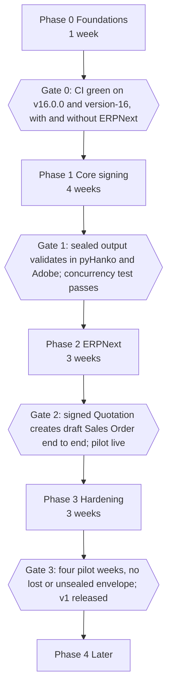

# Frappe Sign: Build Plan

About 8 weeks to a live pilot and 11 weeks to v1, assuming one backend and one frontend developer (or one developer working with Claude Code). Each phase ends at a **gate** that must pass before the next phase starts. Task IDs (`P1.4`) are referenced in commits and PRs.

Conventions for every task:

- Tests first for `pdf/` and `services/` code.
- Done means: code, tests, types pass, lint passes, docs updated if behaviour changed.
- One PR per task or tightly related pair.

---

## Phase 0: Foundations (1 week)

| ID | Task | Done when |
| --- | --- | --- |
| [x] P0.1 | `bench new-app frappe_sign` (title "Frappe Sign", module "Frappe Sign"); `pyproject.toml` with `requires-python = ">=3.14,<3.15"`, `[tool.bench.frappe-dependencies] frappe = ">=16.0.0,<17.0.0"`, Python deps (pypdf, reportlab, pyhanko, arabic-reshaper, python-bidi, qrcode) | `bench install-app` works on a fresh v16.0.0 site |
| [x] P0.2 | Pre-commit: ruff, mypy (strict on `services/`, `pdf/`, `crypto/`), semgrep with Frappe rules + custom rule flagging `ignore_permissions` outside `services/signing.py` and `services/audit.py`, eslint, prettier | `pre-commit run --all-files` clean |
| [x] P0.3 | Package skeleton per ARCHITECTURE.md (empty modules with docstrings), `compat.py`, `exceptions.py` | Import graph matches layer rules |
| [x] P0.4 | DocType JSON for all 17 DocTypes per DESIGN.md section 2, with permissions, plus Roles fixtures (Sign Manager, Sign User) | `bench migrate` clean; controllers stubbed with integrity rules (2.6) implemented and tested |
| [x] P0.5 | Frontend scaffold: Vite + Vue 3 + TS + frappe-ui + Tailwind, two entries (`src/staff`, `src/guest`), router bases, post-build copy to `www/`, `www/sign.py` and `www/s.py` boot context, `website_route_rules` | `/sign` and `/s/x` render a placeholder page |
| [x] P0.6 | GitHub Actions: lint, types, unit + integration on matrix {frappe v16.0.0 + erpnext v16.0.0, version-16 heads} x {with ERPNext, without ERPNext}; frontend build + Vitest | All four matrix cells green |
| [x] P0.7 | Fixture PDFs in `tests/fixtures/pdfs/` (simple A4, Letter, rotated 90, offset CropBox, scanned image, 150 pages, encrypted, with JavaScript, Arabic text) and `coords.json` | Fixtures committed with a README describing each |
| [x] P0.8 | Self-signed test CA + sealing cert `.p12` in `tests/fixtures/certs/` (generated by a script, documented password) | Script reproducible |

**Gate 0:** CI green in all four cells; install and migrate clean on v16.0.0.

---

## Phase 1: Core signing (4 weeks)

### Week 1: PDF core

| ID | Task | Done when |
| --- | --- | --- |
| [x] P1.1 | `pdf/types.py`: `PageMetric`, `Rect`, `Anchor`, `PlacedField`, `FontSet`; coordinate conversion normalized <-> PDF user space honoring rotation and CropBox | Unit tests against `coords.json` for every fixture |
| [x] P1.2 | `pdf/sanitize.py` | Encrypted rejected; JS/OpenAction/AA/EmbeddedFiles/AcroForm stripped; caps enforced |
| [x] P1.3 | `pdf/overlay.py` with Noto Sans + Noto Naskh Arabic, Arabic shaping, checkbox, date, image captures, auto-shrink text to box | Visual snapshot tests (rasterize page with pypdfium2 in tests only, compare to golden PNG with tolerance) |
| [x] P1.4 | `crypto/signer.py` (`Signer`, `Pkcs12Signer`), `crypto/tsa.py`, `pdf/seal.py` PAdES-B-LT | Output validates with pyHanko; integrity and timestamp OK |
| [x] P1.5 | `pdf/certificate.py` + `templates/certificate.html` (branding, signers, events, hashes, QR to `/sign-verify`) | Appended pages render; seal still validates |

### Week 2: Services and audit

| ID | Task | Done when |
| --- | --- | --- |
| [x] P1.6 | `services/audit.py`: append event with chain under row lock; `verify_chain(envelope)` | Tamper test detects first bad event |
| [x] P1.7 | `services/template.py`: create, update, upload PDF (sanitize + metrics), publish version | Version snapshot immutable |
| [x] P1.8 | `services/envelope.py`: create draft from template or upload, send (`send_state`, render job freezes, hashes, issues tokens, writes events), void, remind, resend, expire; explicit transitions with `InvalidTransition` | Lifecycle integration tests |
| [x] P1.9 | `services/signing.py`: open, OTP (email), session, consent, save fields (server validation), capture, finish (intermediate PDF under the row lock, D3), decline, delegate; sequential and parallel routing; Approver flow | Integration tests per path |
| [x] P1.10 | Sealing flow: row lock, `sealing_state`, deduped job, retries, `retry_seal` | Two-thread concurrency test seals once |
| [x] P1.11 | `services/events.py` + `jobs/events.py` (D17) + `services/notify.py` (email only), Email Templates fixtures | Handlers run in jobs after commit and their writes persist; failing handler does not roll back |

### Week 3: APIs and guest app

| ID | Task | Done when |
| --- | --- | --- |
| [x] P1.12 | `api/guest.py` with `@rate_limit`, `X-Sign-Session` handling, PDF streaming | Security tests: rate limit, cross-envelope denial, token rotation |
| [x] P1.13 | `api/staff.py` (Phase 1 subset), `api/public.py` verify | Permission tests for Sign User vs Sign Manager |
| [x] P1.14 | Guest SPA: verify, consent, guided "Next field", signature bottom sheet (draw, type, upload), finish, decline, delegate, terminal screens | Playwright at 390 px width signs a fixture envelope |

### Week 4: Staff app basics

| ID | Task | Done when |
| --- | --- | --- |
| [x] P1.15 | `shared/coords.ts`, PDF viewer component (lazy pages), `useDragResize` | Vitest against `coords.json` |
| [x] P1.16 | Template designer: palette, placement, properties, roles, undo/redo, publish | Designer saves fields that the server overlays at identical positions (fixture round trip test) |
| [x] P1.17 | Send wizard (upload source), envelope list and detail with audit timeline | Manual QA checklist in PR |
| [x] P1.18 | `bench frappe-sign verify` command, `/sign-verify` page | Command reports OK on good, first bad event on tampered |

**Gate 1:** Sealed PDF validates with pyHanko in CI and opens in Adobe Reader showing a valid signature (manual check, screenshot in the PR; self-signed cert trusted locally). Concurrency test passes. Coverage at least 85% on `pdf/` and `services/`.

Gate 1 passed on 2026-10-25: Adobe Reader showed a valid seal on `tests/output/sample_signed.pdf` with the test root trusted; concurrency test passes; coverage `pdf/` 98%, `crypto/` 96%, `services/` 93%. The review also accepted the reportlab certificate and changed D10 (derived link tokens).

---

## Phase 2: ERPNext integration (3 weeks)

| ID | Task | Done when |
| --- | --- | --- |
| [x] P2.1 | `pdf/source.py` Print Format rendering via `frappe.get_print(..., as_pdf=True)`; respects Print Format `pdf_generator` | Works with wkhtmltopdf and chrome generators |
| [x] P2.2 | `jinja/` `sign_field()` helper + `pdf/anchors.py` | Anchors found in both generators for a Quotation Print Format with 3 and 40 items |
| [x] P2.3 | Enabled DocTypes in Sign Settings create custom fields; `erpnext/setup.py` switches `company` fields to Link Company | Custom fields appear, `allow_on_submit` works |
| [x] P2.4 | Resolvers registry + resolvers for Quotation, Sales Order, Purchase Order, Contract, Job Offer (if HRMS), Employee docs, Doc Field | Tests on ERPNext fixtures; missing fields give "unresolved", not errors |
| [x] P2.5 | `public/js/desk.js`: form button + indicator, print view button, list bulk action, send dialog | Manual QA + Playwright for Quotation |
| [x] P2.6 | `services/writeback.py`: attach, `sign_status`, `sign_envelope`, timeline comment, partial status | Integration tests on submitted Sales Order |
| [x] P2.7 | `services/actions.py`: Submit, Apply Workflow Action, Create Mapped Document, Set Field Value, Call Method; runs as sender | Quotation to draft Sales Order test |
| [x] P2.8 | Sign Trigger + `*` dispatcher with cached gate, `enqueue_after_commit`, Sign Trigger Log; lifecycle sync (cancel, delete, source changed, amend) | Dispatcher costs one cache lookup for non-matching DocTypes (asserted in test) |
| [x] P2.9 | Send wizard: Print Format source, detected anchors preview, resolved recipients, prefill | End-to-end from Quotation form |
| [x] P2.10 | Dashboards (`override_doctype_dashboards`) for Customer, Supplier, Employee; Workspace with number cards | Visible on ERPNext fixtures |
| P2.11 | Pilot setup on the chosen real flow; admin guide and Print Format anchor guide in `docs/` | Pilot users trained |

**Gate 2:** Playwright: user submits a Quotation, sends for signature, customer signs on mobile viewport, signed PDF attached, `sign_status = Signed`, draft Sales Order exists. Pilot live.

Gate 2 status on 2026-10-25: the Playwright test passes (`e2e/staff-gate2-quotation.spec.ts`), with the bench worker rendering, sealing through the public TSA, writing back and creating the Sales Order. P2.11 has its guides (`docs/ADMIN_GUIDE.md`, `docs/ANCHOR_GUIDE.md`); the pilot setup on the real site and the user training are open. The wkhtmltopdf anchor tests run only in CI (no wkhtmltopdf on the development Mac).

---

## Phase 2.5: UX (2 weeks)

Make the app easy to understand and pleasant to use before Phase 3. The screen audit, the design direction, the screen designs and the open decisions are in [UX_PLAN.md](UX_PLAN.md). Read it first. Load the `ui-design`, `frontend-design` and `frappe-app-dev` skills before any screen work.

| ID | Task | Done when |
| --- | --- | --- |
| [x] U.1 | Two tangibly different directions for Home, Sent and the guest signing screen, inside the sidebar shell (D18), as a clickable prototype with a Tweak panel (density, list or cards, row detail). Not shipped | User picks a direction |
| [x] U.2 | Foundation: frappe-ui `Sidebar` shell and mobile nav, page header, empty, loading and error states, avatar stack, status badge colors, UI words from UX_PLAN.md through `__()` | Every existing staff page uses the shell and states; Vitest for the shared components |
| [x] U.3 | Home with "Get started" checklist (`setup_status` API: email account, seal, profile, enabled DocTypes, template, test send), "Needs your signature" and "Waiting on others" | On an empty site the checklist leads through setup; Playwright |
| [x] U.4 | Sent list `/sign/requests` (redirect from `/sign/envelopes`): table, avatars, progress, tabs with counts, search, filters, row menu | Playwright; lanes align at 1440 px and 390 px |
| [x] U.5 | Request detail: PDF beside a recipient step list, state-based primary action, plain activity timeline, audit details behind a toggle | Playwright for waiting and completed requests |
| [x] U.6 | Send wizard: DocType and document pickers (Combobox with party, date, total), template cards with thumbnails, people step with autocomplete, check step, sticky footer | Send a Quotation without typing a DocType or a document number; Playwright |
| [x] U.7 | Templates grid with thumbnails; "New template" asks the kind; Print Format template editor in the staff app (DocType, Print Format with sign field check, people, after-sign choices that build the JSON, preview, publish); Desk form intro links to it | Create and publish a Quotation template without Desk; Playwright |
| [x] U.8 | Designer polish: drop zone, palette with icons and groups, compact people panel, save state, icon undo and redo | Visual review at 1440 px; existing designer tests pass |
| [x] U.9 | Settings `/sign/settings`: Company (profiles, sender status, seal status with Create test seal and Upload), Documents (enabled DocTypes, default template), Signing, Advanced | A Sign Manager sees it, a System Manager changes it; integration tests for the new APIs |
| [x] U.10 | Guest page: company branding, clear consent checkbox, progress bar, floating "Next" field button, More menu, review before finish, done and terminal screens | Playwright at 390 px; guest bundle under 250 KB gzipped |
| [x] U.11 | Verify page drop zone and result card; branded invitation, reminder, completed and declined emails | Emails render in Gmail web and Outlook web (manual) |
| [x] U.12 | Desk: cleaner send dialog, Signatures workspace shortcuts, internal DocTypes off the sidebar, headline shows who it waits for | Playwright for the send dialog; Desk script stays a bundle |
| [x] U.13 | QA pass: after screenshots in `docs/ux/after/`, RTL check, keyboard and contrast check, stale-browser check, ADMIN_GUIDE and DESIGN 7 updated | Checklist in UX_PLAN.md "Quality bar" holds for every screen |

**Gate 2.5:** On a fresh site, someone who has not seen the app sets up a company seal, a profile, Quotation and a template, and sends a Quotation for signature, without the docs and without help, in under 15 minutes. The user approves the after screenshots.

---

## Phase 3: Hardening (3 weeks)

| ID | Task | Done when |
| --- | --- | --- |
| [x] P3.1 | WhatsApp OTP and invitation via `frappe_whatsapp` (soft dependency) | Works when installed; cleanly hidden when not |
| [x] P3.2 | Reminders, expiry, certificate expiry warnings, session purge, date triggers | Scheduler tests with frozen time |
| [x] P3.3 | Bulk send from list view (long queue, progress via realtime) | 100 documents processed, per-doc results logged |
| [x] P3.4 | Portal "My Documents" | Contact sees and downloads own signed docs only |
| [x] P3.5 | Full Arabic UI, RTL layout, Arabic Email Templates | RTL visual QA on all screens |
| P3.6 | `RemoteSigner` (PKCS#11 and CSC) behind `Signer` | Tested with SoftHSM in CI |
| P3.7 | Health panel: cert expiry, TSA reachability, oldest queued seal, failed triggers 24 h, SPF/DKIM hints | Visible in settings |
| P3.8 | Security review against DESIGN.md section 5; `pip-audit`, `yarn audit`; load test 150-page PDFs, 50 concurrent signers | Findings fixed or tracked |
| P3.9 | Docs: README, admin guide, API reference, CHANGELOG; tag v1.0.0 | Release published |

**Gate 3:** Four pilot weeks with no lost or unsealed envelope; all Phase 3 tasks done; v1.0.0 tagged.

---

## Phase 4: Later (after v1)

- UAE PASS and qualified signatures; per-signer cryptographic signing.
- In-person signing mode (hand the tablet to the customer).
- PAdES-LTA archival timestamps with periodic re-timestamping.
- Frappe Cloud Marketplace listing.